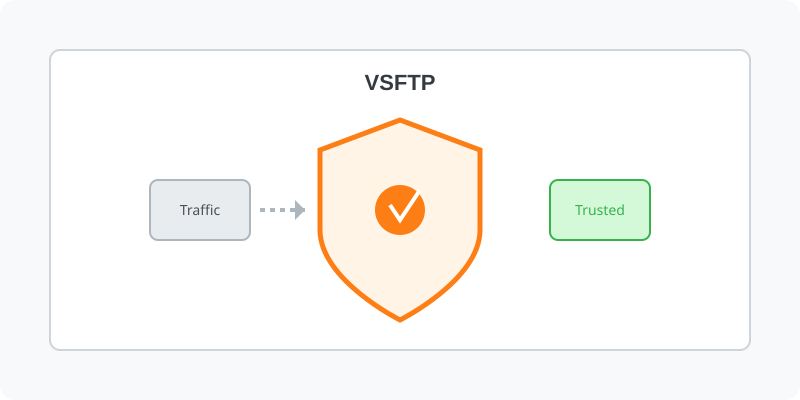

[⬅️ 이전](../) &nbsp;|&nbsp; [🏠 분류 목차](../../../)

# vsFTP
vsftpd(매우 안전한 FTP 데몬)는 Linux 및 Unix 계열 시스템을 위한 가볍고 안전하며 빠른 FTP 서버 소프트웨어입니다. 보안 기능과 단순성으로 유명하여 FTP 서버 설치에 널리 사용됩니다.

방대한 주제를 분할하여 제공합니다.

## 1️⃣ 핵심 학습 가이드
* [vsftpd의 몇 가지 주요 기능](part_1/)

  해당 파트의 상세 내용을 학습합니다.

* [설치하기](part_2/)

  해당 파트의 상세 내용을 학습합니다.

* [anonymous](part_3/)

  해당 파트의 상세 내용을 학습합니다.

## 2️⃣ 심화 및 활용 파트 1
* [방화벽 허용](part_4/)

  해당 파트의 상세 내용을 학습합니다.

* [접속 주소 확인](part_5/)

  해당 파트의 상세 내용을 학습합니다.

* [클라이언트 접속](part_6/)

  해당 파트의 상세 내용을 학습합니다.

## 3️⃣ 심화 및 활용 파트 2
* [계정별 접속](part_7/)

  해당 파트의 상세 내용을 학습합니다.

## 3️⃣ 심화 및 활용 파트 2
---

[⬅️ 이전](../) &nbsp;|&nbsp; [🏠 분류 목차](../../../)
