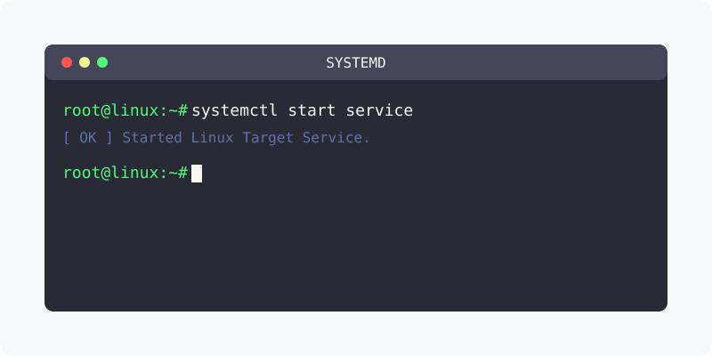

[⬅️ 이전](../) &nbsp;|&nbsp; [🏠 분류 목차](../../../)

# systemd
`systemd`는 리눅스 시스템의 부팅 및 서비스 관리에 사용되는 시스템 및 서비스 관리 도구입니다. 
> systemd는 이전에 사용되던 `SysVinit`와 `Upstart`와 같은 기존 시스템 관리 도구들을 대체하고 있습니다.

방대한 주제를 분할하여 제공합니다.

## 1️⃣ 핵심 학습 가이드
* [Systemd의 역할](part_1/)

  해당 파트의 상세 내용을 학습합니다.

* [systemd 프로세스](part_2/)

  해당 파트의 상세 내용을 학습합니다.

## 2️⃣ 심화 및 활용 파트 1
* [systemd 동작](part_3/)

  해당 파트의 상세 내용을 학습합니다.

* [systemctl](part_4/)

  해당 파트의 상세 내용을 학습합니다.

## 3️⃣ 심화 및 활용 파트 2
* [Service 명령](part_5/)

  해당 파트의 상세 내용을 학습합니다.

* [Service 파일 속성](part_6/)

  해당 파트의 상세 내용을 학습합니다.

## 3️⃣ 심화 및 활용 파트 2
---

[⬅️ 이전](../) &nbsp;|&nbsp; [🏠 분류 목차](../../../)
