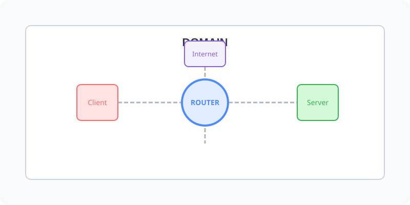

[⬅️ 이전: 10.3 주요 네트워크 서비스](../) &nbsp;|&nbsp; [🏠 분류 목차](../../../../) &nbsp;|&nbsp; [다음: wget https://bitnami.com/redirect/to/654754/bitnami-lampstack-7.2.21-0-linux-x64-installer.run ➡️](../lapm/)

# 도메인

## 도메인 등록기관

* [구글 도메인](https://domains.google.com)
* [하프도메인](https://www.halfdomain.co.k) 

---

[⬅️ 이전: 10.3 주요 네트워크 서비스](../) &nbsp;|&nbsp; [🏠 분류 목차](../../../../) &nbsp;|&nbsp; [다음: wget https://bitnami.com/redirect/to/654754/bitnami-lampstack-7.2.21-0-linux-x64-installer.run ➡️](../lapm/)
