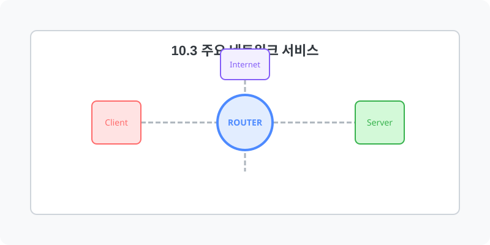
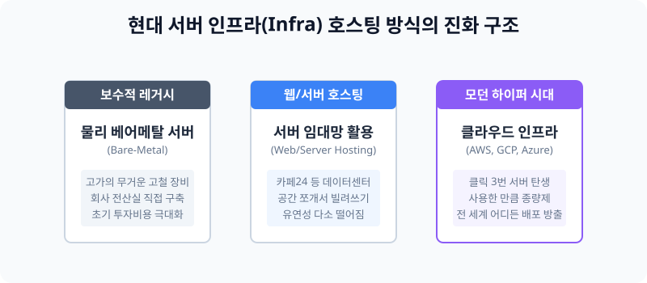

[⬅️ 이전: systemd](../08_1_1_demon/systemd/) &nbsp;|&nbsp; [🏠 분류 목차](../../../) &nbsp;|&nbsp; [다음: 도메인 ➡️](domain/)



# 10.3 서비스를 대중에게 배포하는 인프라 방식의 진화

리눅스 웹 서버(Apache, Nginx 등) 설정과 데몬 구동법을 모두 익혔다면, 이제 나 혼자 볼 것이 아니라 외부 인터넷의 불특정 다수 대중들에게 이 "서비스를 오픈"해야 합니다. 이를 위해 서버의 물리적 공간을 얻어 내는 큰 세 가지 흐름이 존재합니다.


> **동작 원리**: 과거에는 기업의 어두운 전산실 밑바닥에 에어컨을 빵빵하게 틀어놓고 무거운 기계 쇳덩이를 돌렸습니다. 그러나 시대가 흐르면서 서버를 조각내어 빌려 쓰더니, 점차 마우스 클릭 하나로 수백 대의 시스템을 순식간에 구워내는 가상화 클라우드(Cloud) 시대로 완벽히 넘어왔습니다.

---

## 1. 물리 서버 직접 구축 (Legacy On-Premise)

내 서버를 내가 내 눈앞의 자리에 거금을 주고 샀다! 는 방식입니다.
### 1.1 특징 및 장단점
* **장점**: 모든 하드웨어 모듈과 운영체제 제어권을 기업이 독점하므로, 다른 타사의 정보 노출 염려가 없고 아주 미세한 커스텀 세팅이 가능합니다.
* **단점**: 서버 가격은 수백만 원에서 수천만 원까지 호가합니다. 전기세 폭탄과 하드디스크 고장 처리까지 내가 모두 독박을 써야 하며, 만약 트래픽이 몰려 갑자기 서버가 다운되어버리면 새 부품이 배달될 때까지 손가락만 빨고 있어야 합니다.

---

## 2. 웹/서버 호스팅 (Hosting)

물리 장비를 남의 데이터센터 시설에서 유지보수해주고, 나는 그 빈방에 월세를 내고 전월세살이를 하는 개념입니다. 
### 2.1 서버 호스팅 vs 웹 호스팅
* **웹 호스팅(Web)**: 내 홈페이지 그림판 정도만 띄울 수 있는 코딱지만한 방 한편을 저렴하게 빌립니다. 권한이 아예 없어 우분투/데비안 등 운영체제를 내 맘대로 세팅할 수조차 없습니다.
* **서버 호스팅(Server / VPS)**: 아예 원룸 한 층을 다 빌려서 root 시스템 제어 권한을 받습니다.

---

## 3. 현대 인프라의 표준, 클라우드 (Cloud) 컴퓨팅

서버를 고철 물리 덩어리가 아니라 완전한 "논리적인 가상의 0과 1 데이터 덩어리"로 구워내버리는 4차 산업 혁명 기술입니다. AWS(Amazon Web Service), GCP(Google), Azure(MS) 가 그 주인공들입니다.

### 3.1 클라우드 인프라의 파괴력
* **즉각적인 서버 탄생**: AWS 콘솔 화면에 접속해서 "우분투 20.04 1대 줘" 하고 마우스 클릭을 다닥다닥 누르는 1분 만에, 전 세계 인터넷 망에 내 IP가 세워집니다.
* **탄력성 보장 (Auto-Scaling)**: 갑자기 BTS 콘서트 티켓팅이 열려서 수만 명의 조회 트래픽이 몰려 내 서버가 뻗을 거 같다면, 클라우드 시스템이 알아서 서버 컴퓨터 대수를 10대로 증식시켰다가 조용해지면 다시 1대로 축소시켜 버립니다.
* **종량제 비용 결제**: 물리 서버 샀을 땐 서버를 안 켜둬도 100만 원이라는 돈이 사라졌지만, 클라우드는 당신이 2시간 동안 컴퓨터를 켜서 쓴 "전기세 타임" 만큼만 십 원 단위로 정산해 빼갑니다.

---

## 4. [실습] 나의 리눅스 환경 정체성 점검

현재 당신의 리눅스 터미널이 로컬 가상머신인지, 아니면 어딘가 빌려 쓴 원격 머신 IP인지 확인해 봅니다.

### 실습 1. 물리적 장비 정체성 점검
```bash
# 내 컴퓨터의 CPU 속도와 아키텍처, 물리적 구성 및 논리 코어 갯수를 출력해 봅니다.
lscpu

# 이 장비가 언제 처음 켜져서 얼마나 연속으로 구동되고 있는지 확인합니다.
uptime
```

---

[⬅️ 이전: systemd](../08_1_1_demon/systemd/) &nbsp;|&nbsp; [🏠 분류 목차](../../../) &nbsp;|&nbsp; [다음: 도메인 ➡️](domain/)
