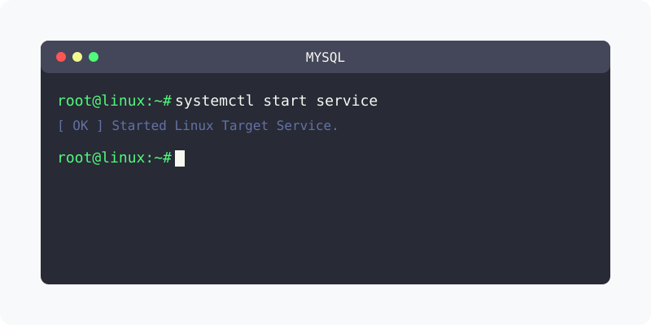

[⬅️ 이전](../) &nbsp;|&nbsp; [🏠 분류 목차](../../../)



# mariaDB를 설치합니다.

```console
hojin@DESKTOP-11LMH3B:~$ dpkg -l | grep mysql
hojin@DESKTOP-11LMH3B:~$ dpkg -l | grep mariadb
```
기본 설치가 되어 있지 않습니다.

`mariaDB-server`를 설치합니다.

```console
sudo apt -y install mariadb-server
```

설치된 페키지를 확인합니다.

```console
hojin@DESKTOP-11LMH3B:~$ dpkg -l | grep "mariadb"
ii  mariadb-client-10.3            1:10.3.22-1ubuntu1                amd64        MariaDB database client binaries
ii  mariadb-client-core-10.3       1:10.3.22-1ubuntu1                amd64        MariaDB database core client binaries
ii  mariadb-common                 1:10.3.22-1ubuntu1                all          MariaDB common metapackage
ii  mariadb-server                 1:10.3.22-1ubuntu1                all          MariaDB database server (metapackage depending on the latest version)
ii  mariadb-server-10.3            1:10.3.22-1ubuntu1                amd64        MariaDB database server binaries
ii  mariadb-server-core-10.3       1:10.3.22-1ubuntu1                amd64        MariaDB database core server files
```

`서버`와 `클라이언트`가 모두 설치가 된것을 확인할 수 있습니다.

## 1️⃣ 핵심 학습 가이드
방대한 주제를 분할하여 제공합니다.

* [프로세스 확인](part_1/)

  해당 파트의 상세 내용을 학습합니다.

* [mysql 접속하기](part_2/)

  해당 파트의 상세 내용을 학습합니다.

---

[⬅️ 이전](../) &nbsp;|&nbsp; [🏠 분류 목차](../../../)
