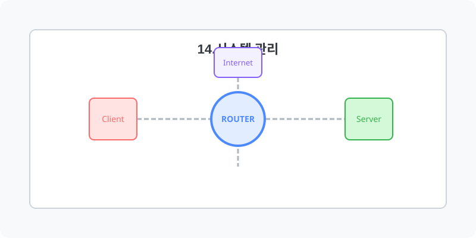

[⬅️ 이전: 8장. 서비스와 데몬 (Demon)](../) &nbsp;|&nbsp; [🏠 분류 목차](../../) &nbsp;|&nbsp; [다음: 10.1 데몬(Daemon)의 개요 ➡️](08_1_1_demon/)

## 14.시스템 관리
---
시스템을 위한 리눅스 서버를 운영하는 경우, 시스템 관리를 위하여 네트워크 상황을 상시 모니터링하고 관리해야 하는 업무는 중요한 업무이다.

### 14-1.서버 모니터링과 알림 설정
시스템 모니터링은 서버나 시스템의 성능 및 상태를 지속적으로 감시하여 이상 현상을 조기에 파악하고 대응할 수 있는 작업입니다.  

## 1️⃣ 핵심 학습 가이드
* [시스템 측정 및 상태](/system/monitor)

* [로그 파일과 시스템 모니터링](/system/monitor/log)
* [패킷 분석 및 디버깅 도구의 사용 방법](/system/monitor/packet)

## 2️⃣ 심화 및 활용 파트 1
* [tar를 이용한 백업과 복구](/system/backup)
* [rsync를 이용한 백업과 복구](/system/backup)
* [dd를 이용한 백업과 복구](/system/backup)

## 3️⃣ 심화 및 활용 파트 2
* [원격 백업](/system/backup)

## 3️⃣ 심화 및 활용 파트 2
### 14-2.시스템 백업과 복구
백업 및 복구는 데이터를 잃거나 손상되는 경우를 대비하여 중요한 정보를 보호하기 위해 데이터를 저장하고 복원하는 과정입니다.  
### 14-3.시스템 로그

### 14-4.외부도구
* Zabbix 서버 설치와 설정

---

[⬅️ 이전: 8장. 서비스와 데몬 (Demon)](../) &nbsp;|&nbsp; [🏠 분류 목차](../../) &nbsp;|&nbsp; [다음: 10.1 데몬(Daemon)의 개요 ➡️](08_1_1_demon/)
