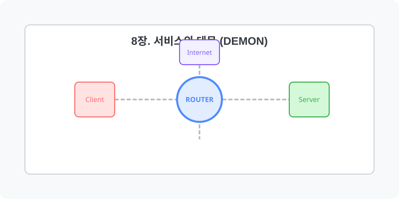

[⬅️ 이전: ufw](../07_network/06_4_security/06_1_9_firewall/ufw/) &nbsp;|&nbsp; [🏠 분류 목차](../) &nbsp;|&nbsp; [다음: 14.시스템 관리 ➡️](08_1_basic/)

# 8장. 서비스와 데몬 (Demon)

백그라운드에서 동작하는 시스템 데몬(Daemon)의 개념과 Systemd를 활용한 핵심 프로세스 제어 기법을 알아봅니다.
아래의 세부 학습 주제를 챕터별로 클릭하여 상세 레퍼런스를 확인하세요.

## 1️⃣ 핵심 학습 목차
본 단원의 세부 커리큘럼을 안내합니다.

* [8.1 Basic](08_1_basic/)
  * 학습 내용: `demon, server`

* [8.2 Daemon](08_2_daemon/)
  * 학습 내용: `concept, systemd, service`

---

[⬅️ 이전: ufw](../07_network/06_4_security/06_1_9_firewall/ufw/) &nbsp;|&nbsp; [🏠 분류 목차](../) &nbsp;|&nbsp; [다음: 14.시스템 관리 ➡️](08_1_basic/)
