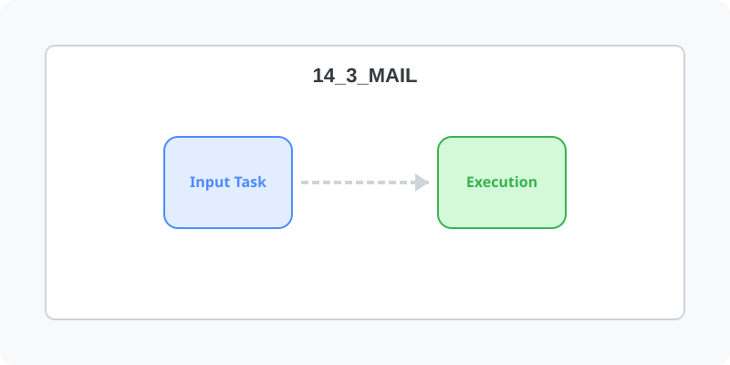

[⬅️ 이전: 14.2 Samba (삼바 파일서버)](../14_2_samba/) &nbsp;|&nbsp; [🏠 분류 목차](../../) &nbsp;|&nbsp; [다음: 14.4 FTP (vsftpd 구축) ➡️](../14_4_ftp/)

# 14.3 메일 서버 (Postfix/Dovecot)

웹 서버의 폼에서 이메일을 자체 발송하거나, 사내 직원들끼리 메일을 주고받기 위해 `Postfix`(발송용 SMTP)와 `Dovecot`(수신용 POP3/IMAP)을 구축합니다.

---

[⬅️ 이전: 14.2 Samba (삼바 파일서버)](../14_2_samba/) &nbsp;|&nbsp; [🏠 분류 목차](../../) &nbsp;|&nbsp; [다음: 14.4 FTP (vsftpd 구축) ➡️](../14_4_ftp/)
