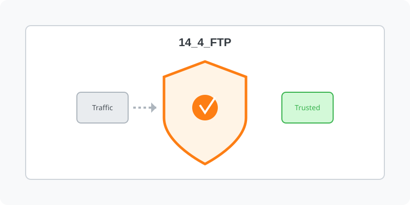

[⬅️ 이전: 14.3 메일 서버 (Postfix/Dovecot)](../14_3_mail/) &nbsp;|&nbsp; [🏠 분류 목차](../../) &nbsp;|&nbsp; [다음: 9장. 웹 서비스 구축 (Web) ➡️](../../10_web/)

# 14.4 FTP (vsftpd 구축)

보안과 권한이 적용된 원격 파일 송수신을 위해 `vsftpd` 데몬을 설치하여 강력한 파일 전송 구간을 개통합니다.

---

[⬅️ 이전: 14.3 메일 서버 (Postfix/Dovecot)](../14_3_mail/) &nbsp;|&nbsp; [🏠 분류 목차](../../) &nbsp;|&nbsp; [다음: 9장. 웹 서비스 구축 (Web) ➡️](../../10_web/)
