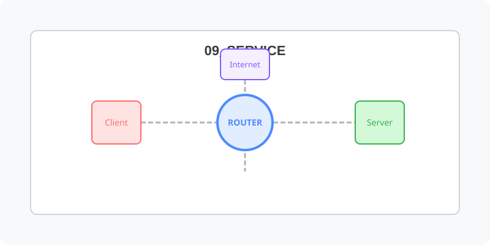

[⬅️ 이전: 10.3 주요 네트워크 서비스](../08_demon/08_2_daemon/08_2_3_service/) &nbsp;|&nbsp; [🏠 분류 목차](../) &nbsp;|&nbsp; [다음: 14.1 NFS (Network File System) ➡️](14_1_nfs/)

# 14장. 필수 네트워크 서비스 (Services)

리눅스 시스템을 사내 인프라 서버로 활용하기 위한 파일 공유(NFS/Samba), 메일 발송망, 자료 전송(FTP) 서비스 로직을 심층 구축합니다.

## 1️⃣ 핵심 학습 가이드
* [14.1 NFS (서버간 볼륨 공유)](14_1_nfs/)

* [14.2 Samba (윈도우용 사내 파일서버)](14_2_samba/)

## 2️⃣ 심화 및 활용 파트 1
* [14.3 Mail (Postfix 사내 메일)](14_3_mail/)

* [14.4 FTP (대용량 전송 프로토콜)](14_4_ftp/)

---

[⬅️ 이전: 10.3 주요 네트워크 서비스](../08_demon/08_2_daemon/08_2_3_service/) &nbsp;|&nbsp; [🏠 분류 목차](../) &nbsp;|&nbsp; [다음: 14.1 NFS (Network File System) ➡️](14_1_nfs/)
