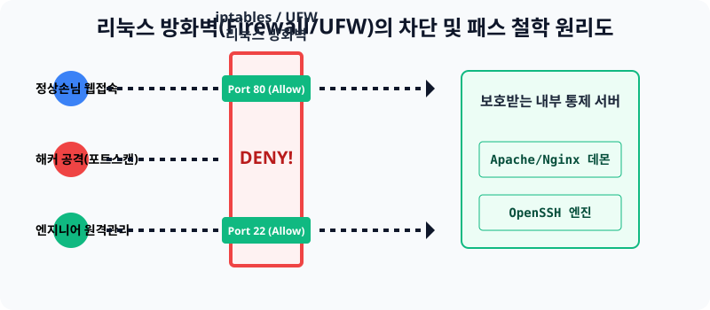

# 14.3 불법 접속의 통곡의 벽, 방화벽(Firewall) 통제

앞에서 웹 서버도 켜놓고 데이터베이스 엔진도 돌아가게 만들었지만, 애초에 리눅스 운영체제는 설치되는 그 순간부터 **"모든 무단 외지인의 방문 통로(Port)를 적대하고 틀어막는다"** 는 철저한 폐쇄 정책을 기본 탑재하고 있습니다. 내 서버에 접속하려는 트래픽을 허락(Allow)하거나 차단(Deny)하는 거대한 보안 문지기가 바로 방화벽입니다.


> **동작 원리**: 해커가 내 데몬을 털기 위해 패킷을 날려도, 데몬에까지 닿기 전에 운영체제 맨 앞단의 방화벽 모듈(iptables/UFW)에 의해 걸러져서 파괴(Drop/Deny)됩니다. 오로지 엔지니어가 직접 문을 열어준 포트 번호(예: 80, 22번 등)를 향해 들어온 전기 신호만 안전하게 서버 안쪽 데몬의 귀에 떨어집니다.

---

## 1. 리눅스 양대 산맥의 방화벽 체계 차이
리눅스 커널 안에는 사실 `Netfilter(넷필터)` 라는 코어 보안 엔진이 가장 바닥에서 움직이고 있습니다. 근데 이것을 명령어로 통제하기가 머리가 터질 듯이 어렵기 때문에, 각 OS 진영마다 조금 더 사용자가 타이핑하기 편하게 만든 **명령어 껍데기 툴킷(Wrapper)** 을 개발하여 배포했습니다.

### 1-1. Ubuntu / Debian 진영 ➡️ UFW (Uncomplicated Firewall)
* 너무 복잡한 넷필터 문법을 영어 단어 수준으로 "복잡하지 않게(Uncomplicated)" 래핑한 우분투 전용 방화벽입니다.
* 사용 예시: `sudo ufw allow 22/tcp` (너무 직관적입니다!)

### 1-2. CentOS / Rocky 진영 ➡️ FirewallD (파이어월디)
* 레드햇 생태계에서 공식으로 사용하는 방화벽 데몬 체계입니다. XML 기반의 존(Zone) 메커니즘을 사용해 공공기관 등에서 네트워크 망을 섬세하게 분리할 때 사용합니다.
* 사용 예시: `sudo firewall-cmd --permanent --add-port=80/tcp` (길이가 길고 외우기 조금 귀찮습니다.)

---

## 2. [개념 정리] 현대 클라우드의 이중 방화벽 (Security Group)
혹시 현재 실습을 윈도우 안에 구성된 로컬 가상머신이 아니라, AWS 클라우드 EC2 환경으로 배포하여 진행하고 터미널을 치고 계시다면 알아두셔야 할 사실이 있습니다.

가상 클라우드 서버는 **물리적으로 두 번 랩핑된 방화벽 시스템**을 가집니다.
1. **서버 내부의 우분투 OS 방화벽(UFW)**: 시스템 엔지니어가 지금 치고 있는 권한입니다.
2. **AWS 웹 콘솔의 보안 그룹(Security Group)**: 운영체제보다 더 바깥쪽(인터넷 망 자체)에서 걸고 넘어지는 클라우드 사설 보안 필터입니다.
* 즉 우분투 터미널 안에서 80번 포트를 미친듯이 `allow` 를 쳐서 뚫어놓아도, AWS 웹사이트 화면에서 EC2의 인바운드 보안그룹 개방 버튼을 안 찍어뒀다면 서버는 두 번째 외부 차단벽에 막혀 영원히 무응답에 빠집니다!

---

## 3. [실습] 실전 UFW 방화벽 통나무 뚫고 막기 연습

당신의 우분투 서버를 타겟으로 가상의 통신 문을 개방하고 처단하는 최종 훈련입니다.

### 실습 1. 방화벽 엔진 가동 상태 확인
방화벽 엔진이 죽어있다면 모든 문이 활짝 열려 있다는 뜻입니다.
```bash
# 내 방화벽 상태가 inactive 인지 active 인지 확인
sudo ufw status

# 혹시 꺼져있다면 강제로 기지개를 켜게 합니다 (터미널 튕김 주의 경고가 뜹니다 y!)
sudo ufw enable
```

### 실습 2. 웹 서버(HTTP/HTTPS) 항구 무조건 뚫어두기
```bash
# 대중들에게 서비스할 80번(http)과 443번(https 암호화) TCP 항구를 명확히 오픈합니다.
sudo ufw allow 80/tcp
sudo ufw allow 443/tcp
```

### 실습 3. 해커의 공격 포트 차단해버리기!
만약 중국이나 인도에서 데이터베이스가 돌아가는 중요한 3306 포트를 자꾸 스캔하면서 암호를 뚫으려 든다면, 방화벽 문 바깥에 강력한 바리케이드를 쳐서 영구 드랍(Deny) 시켜 버려야 합니다.
```bash
# 3306 포트로 접근하는 모든 외부 트래픽을 단두대로 차단 발동!
sudo ufw deny 3306/tcp

# 마지막으로 내 서버의 방화벽 규칙 지시서가 내 맘대로 세팅되었는지 최종 검증!
sudo ufw status verbose
```
