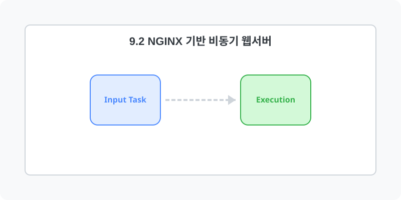

[⬅️ 이전: 9.1 Apache 서버 구축](../09_1_apache/) &nbsp;|&nbsp; [🏠 분류 목차](../../) &nbsp;|&nbsp; [다음: 9.3 WAS 연동 (Tomcat/PHP) ➡️](../09_3_was/)

# Nginx

Nginx는 가벼우면서도 비동기 이벤트 처리 구조를 가져 대규모 트래픽 처리에 특화된 웹 서버입니다.

---

[⬅️ 이전: 9.1 Apache 서버 구축](../09_1_apache/) &nbsp;|&nbsp; [🏠 분류 목차](../../) &nbsp;|&nbsp; [다음: 9.3 WAS 연동 (Tomcat/PHP) ➡️](../09_3_was/)
