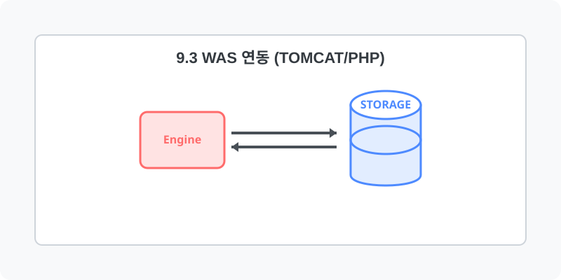

[⬅️ 이전: 9.2 Nginx 기반 비동기 웹서버](../09_2_nginx/) &nbsp;|&nbsp; [🏠 분류 목차](../../) &nbsp;|&nbsp; [다음: 10장. 데이터베이스 서버 (Database) ➡️](../../11_database/)

# WAS (Web Application Server)

웹 서버의 정적 한계를 극복하고 동적 서비스를 제공하기 위해 PHP-FPM이나 Tomcat을 프록시로 연동합니다.

---

[⬅️ 이전: 9.2 Nginx 기반 비동기 웹서버](../09_2_nginx/) &nbsp;|&nbsp; [🏠 분류 목차](../../) &nbsp;|&nbsp; [다음: 10장. 데이터베이스 서버 (Database) ➡️](../../11_database/)
