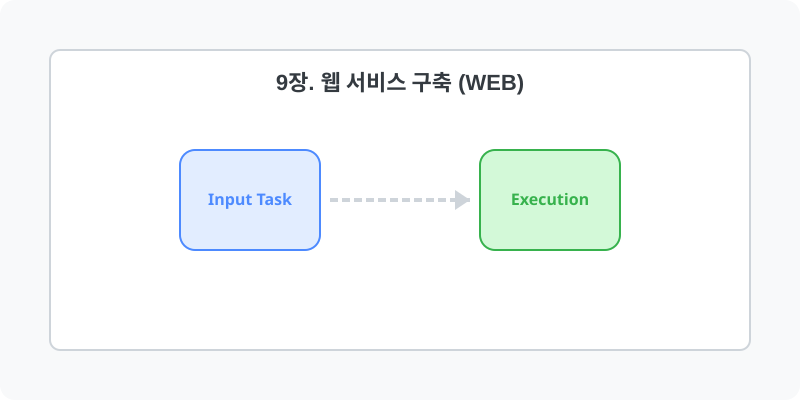

[⬅️ 이전: 14.4 FTP (vsftpd 구축)](../09_service/14_4_ftp/) &nbsp;|&nbsp; [🏠 분류 목차](../) &nbsp;|&nbsp; [다음: 9.1 Apache 서버 구축 ➡️](09_1_apache/)

# 9장. 웹 서비스 구축 (Web)

Apache, Nginx 등 엔터프라이즈 레벨의 웹 서버 인프라를 구축하고 웹 애플리케이션 아키텍처를 구성합니다.
아래의 세부 학습 주제를 챕터별로 클릭하여 상세 레퍼런스를 확인하세요.

## 1️⃣ 핵심 학습 목차
본 단원의 세부 커리큘럼을 안내합니다.

* [9.1 Web Server](09_1_web_server/)
  * 학습 내용: `web`

* [9.2 Web Server 11](09_2_web_server_11/)

* [9.3 Webserver](09_3_webserver/)
  * 학습 내용: `intro, apache, nginx`

---

[⬅️ 이전: 14.4 FTP (vsftpd 구축)](../09_service/14_4_ftp/) &nbsp;|&nbsp; [🏠 분류 목차](../) &nbsp;|&nbsp; [다음: 9.1 Apache 서버 구축 ➡️](09_1_apache/)
