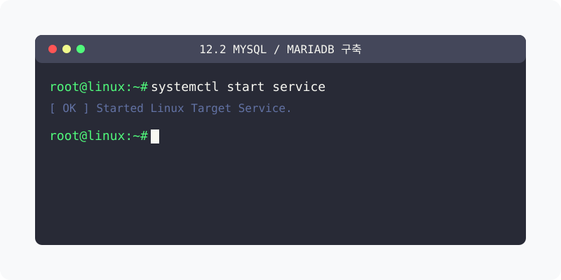
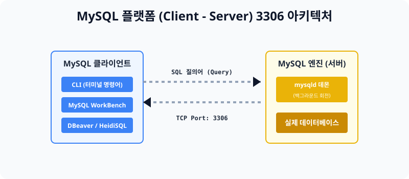

[⬅️ 이전: 12.1 데이터베이스 구조 개요](../10_1_1_intro/) &nbsp;|&nbsp; [🏠 분류 목차](../../../) &nbsp;|&nbsp; [다음: 12.3 웹/DB 연동 (PHP/Node) 기초 ➡️](../10_1_3_webdb/)



# 12.2 MySQL (MariaDB) 기본 설치 및 데몬 구동

가장 표준형인 오픈소스 데이터베이스 `MySQL`을 우분투 리눅스 환경에 배포하고, 구동시키는 방법을 배웁니다.


> **동작 원리**: MySQL을 설치하면 내부에 2가지 프로그램이 깔립니다. 하나는 365일 3306 포트를 열어두고 데이터를 쥐고 있는 뒤쪽의 악덕 사장, **'MySQL 서버(mysqld)'** 유령 엔진이고 다른 하나는 사장에게 SQL 문을 전달해 주는 **'MySQL 클라이언트'** 프로그래밍입니다. 우리는 클라이언트를 거쳐 타건합니다.

---

## 1. [실습] 패키지를 통한 데이터베이스 엔진 다운로드

과거에는 MySQL을 수동으로 컴파일해야 했지만 현재는 `apt` 툴킷을 통해 최신 버전을 원틱으로 설치 가능합니다.

### 실습 1. 패키지 엔진 설치
```bash
# APT 툴킷으로 다운로드를 실행합니다.
sudo apt update
sudo apt install -y mysql-server
```

### 실습 2. 관리자(root) 패스워드 최초 강제 설정
설치가 완료되어도 최초에는 비밀번호가 없어서 보안이 뻥 뚫려 있습니다. `mysql_secure_installation` 이라는 기본 방어 스크립트를 즉시 가동하여 비밀번호를 세팅합니다.
```bash
# 보안 스크립트 가동 (엔터를 치고 무조건 y를 누르며 패스워드를 1234로 고정합니다)
sudo mysql_secure_installation
```
*(주의사항: `VALIDATE PASSWORD COMPONENT` 설정은 가급적 `No`를 하세요. 비밀번호를 길게 설정하라는 귀찮은 제약이 걸립니다.)*

### 실습 3. 데몬 리모콘 활성화 및 상태 체크
이전 단원에서 활용한 `systemctl` 을 이용해 서버가 살아있는지 점검합니다. 
```bash
# mysql(엔진) 상태 확인
sudo systemctl status mysql
```

---

## 2. 데이터베이스 클라이언트 툴의 종류

MySQL 데몬이 살아서 뛰기 시작했다면, 데이터를 이 엔진으로 밀어 넣어야 합니다. 검은 화면에서 타건할 수 있지만, 현업에서는 그림판처럼 생긴 최신 GUI 툴들을 주로 활용해 외부 IP를 통해 들어옵니다.

1. **MySQL WorkBench (오리지널)**: 오라클 사에서 직접 만든 공식 무료 클라이언트입니다. 조금 무겁습니다.
2. **DBeaver (디비버)**: 코끼리 로고를 쓴 전 세계 1등 자바 기반 데이터베이스 연결 프로그램입니다.
3. **HeidiSQL (하이디)**: 윈도우 OS 개발자들의 영원한 단짝인 가벼운 최강 클라이언트 툴입니다.

---

## 3. [실습] MySQL 데몬 안으로 침투하기

만약 GUI 툴이 없는 환경이라면, 우분투 서버 CLI 검은 터미널 창을 통해서라도 접속이 가능합니다.

### 실습 1. CLI 터미널 직접 침투
클라이언트 접속 명령 포맷은 무조건 `mysql -u {아이디} -p(패스워드 입력 모드)` 입니다.
```bash
# 최고 무결성 권한인 root 계정으로 엔진 안으로 접속해 봅니다.
sudo mysql -u root -p
# (이후 아까 세팅한 1234 비밀번호를 타건합니다)
```

### 실습 2. 내장 데이터베이스 목록 까보기
엔진 안쪽(mysql> 프롬프트)으로 화면이 전환되었다면, 성공입니다! 다음 SQL 쿼리를 날려봅니다.
```sql
-- 내 서버에 기본적으로 만들어진 하얀 데이터 도화지(Database) 목록을 보여줘!
SHOW DATABASES;
```
결과로 `mysql`, `information_schema` 등의 기본 도화지 구조물들을 확인하실 수 있습니다. 빠져나오려면 `exit`를 칩니다.

---

[⬅️ 이전: 12.1 데이터베이스 구조 개요](../10_1_1_intro/) &nbsp;|&nbsp; [🏠 분류 목차](../../../) &nbsp;|&nbsp; [다음: 12.3 웹/DB 연동 (PHP/Node) 기초 ➡️](../10_1_3_webdb/)
