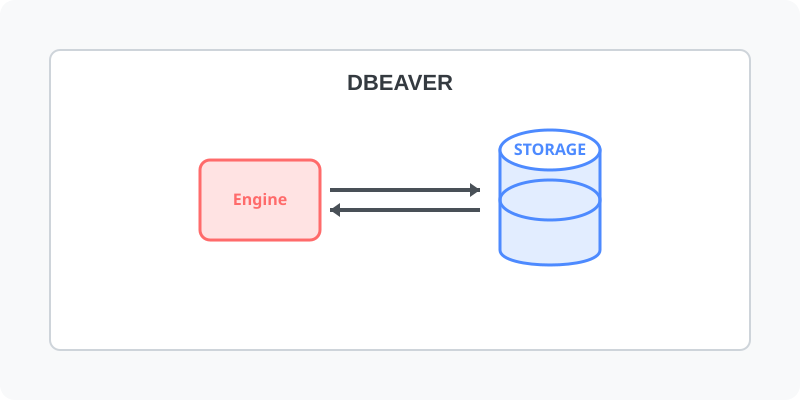

[⬅️ 이전: 12.1 데이터베이스 구조 개요](../../) &nbsp;|&nbsp; [🏠 분류 목차](../../../../) &nbsp;|&nbsp; [다음: Heidisql ➡️](../heidisql/)

## DBEaver
mysql 말고도 다양한 데이터베이스에 접속하여 관리할 수 있습니다.

---

[⬅️ 이전: 12.1 데이터베이스 구조 개요](../../) &nbsp;|&nbsp; [🏠 분류 목차](../../../../) &nbsp;|&nbsp; [다음: Heidisql ➡️](../heidisql/)
