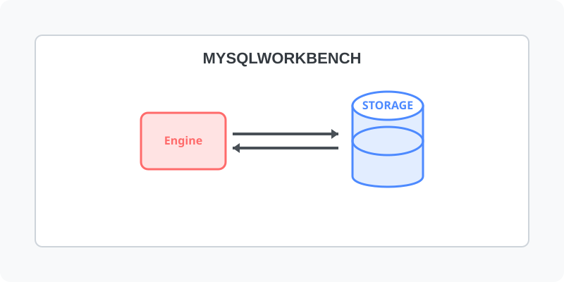

[⬅️ 이전: Heidisql](../heidisql/) &nbsp;|&nbsp; [🏠 분류 목차](../../../../) &nbsp;|&nbsp; [다음: MariaDB 설치하기 ➡️](../../10_3_2_mariadb/)

# MysqlWorkBench
`MysqlWorkBench`는 GUI 방식으로 mysql 데이터베이스에 접속을 관리하는 클리이언트 입니다.

---

[⬅️ 이전: Heidisql](../heidisql/) &nbsp;|&nbsp; [🏠 분류 목차](../../../../) &nbsp;|&nbsp; [다음: MariaDB 설치하기 ➡️](../../10_3_2_mariadb/)
