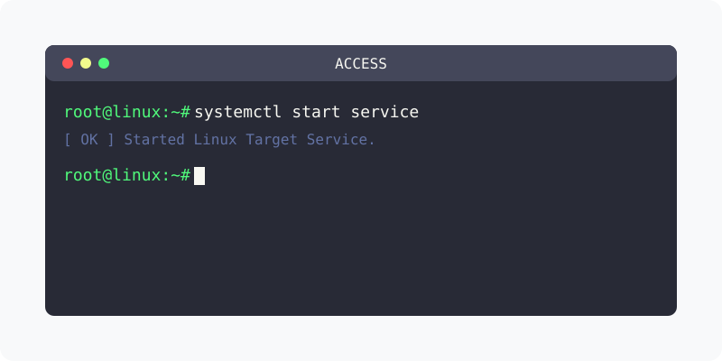

[⬅️ 이전](../) &nbsp;|&nbsp; [🏠 분류 목차](../../../)

# 외부접속
로컬 컴퓨터외의 컴퓨터에서 접속을 하기 위해서는 접근을 허용해 주어야 합니다.

 

## 1️⃣ 핵심 학습 가이드
방대한 주제를 분할하여 제공합니다.

* [외부에서 접속하기](part_1/)

  해당 파트의 상세 내용을 학습합니다.

* [외부 접속을 위한 root 사용자 계정 변경](part_2/)

  해당 파트의 상세 내용을 학습합니다.

* [원격으로 접속하기](part_3/)

  해당 파트의 상세 내용을 학습합니다.

---

[⬅️ 이전](../) &nbsp;|&nbsp; [🏠 분류 목차](../../../)
