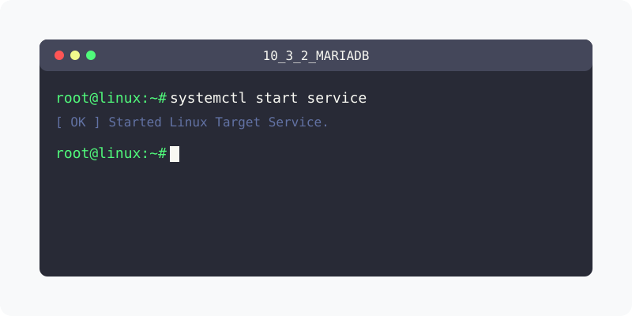

[⬅️ 이전: MysqlWorkBench](../10_3_1_client/mysqlworkbench/) &nbsp;|&nbsp; [🏠 분류 목차](../../../) &nbsp;|&nbsp; [다음: 외부접속 ➡️](access/)

# MariaDB 설치하기
---
Mariadb를 설채해 보도록 합니다.

 

* MariaDB [패키지설치](./package/)

## 1️⃣ 핵심 학습 가이드
* [테스트](./test/) 및 접속하기

* [시작/정지/상태/활성화](./service/)

## 2️⃣ 심화 및 활용 파트 1
* [환경설정](env)

 

* [root 패스워드](./root/)

## 3️⃣ 심화 및 활용 파트 2
* [외부접속](./access/)

## 3️⃣ 심화 및 활용 파트 2
## 환경 설정하기
---
MariaDB를 사용하기 위한 간단한 설정을 합니다.

---

[⬅️ 이전: MysqlWorkBench](../10_3_1_client/mysqlworkbench/) &nbsp;|&nbsp; [🏠 분류 목차](../../../) &nbsp;|&nbsp; [다음: 외부접속 ➡️](access/)
