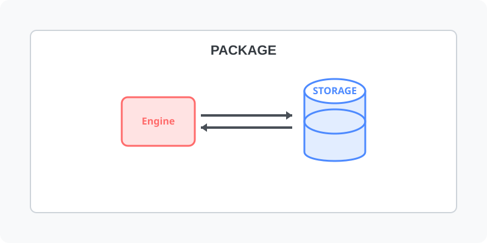

[⬅️ 이전](../) &nbsp;|&nbsp; [🏠 분류 목차](../../../)

# 마리아DB 패키지 설치
패키지를 이용하여 MariaaDB를 설치해 보도록 합니다.

 

방대한 주제를 분할하여 제공합니다.

## 1️⃣ 핵심 학습 가이드
* [설치 여부 확인](part_1/)

  해당 파트의 상세 내용을 학습합니다.

* [MariaDB 최신버젼](part_2/)

  해당 파트의 상세 내용을 학습합니다.

## 2️⃣ 심화 및 활용 파트 1
* [패키지 설치](part_3/)

  해당 파트의 상세 내용을 학습합니다.

* [버젼확인하기](part_4/)

  해당 파트의 상세 내용을 학습합니다.

---

[⬅️ 이전](../) &nbsp;|&nbsp; [🏠 분류 목차](../../../)
