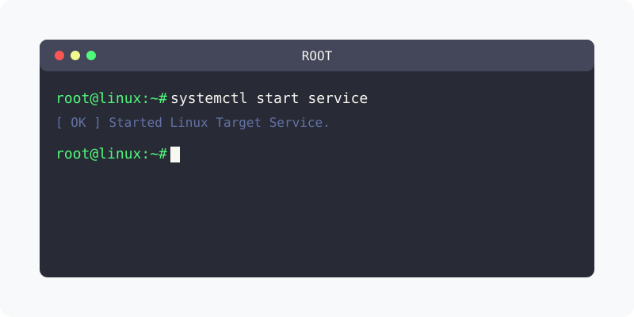

[⬅️ 이전](../) &nbsp;|&nbsp; [🏠 분류 목차](../../../)

# root 설정하기
앞에서 우리는 비밀번호를 지정하지 않아도 MariaDB에 접속이 가능하였습니다. 

Mysql 명령어만 실행하면, 현재 운영체제 사용자와 같은 이름인 root로 비밀번호 없이 접속이 되는 것이다.

 

## 1️⃣ 핵심 학습 가이드
방대한 주제를 분할하여 제공합니다.

* [root 비밀번호](part_1/)

  해당 파트의 상세 내용을 학습합니다.

* [mysql root 비빌번호 분실](part_2/)

  해당 파트의 상세 내용을 학습합니다.

---

[⬅️ 이전](../) &nbsp;|&nbsp; [🏠 분류 목차](../../../)
