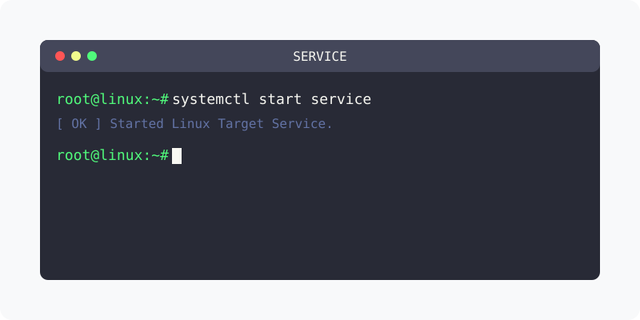

[⬅️ 이전](../) &nbsp;|&nbsp; [🏠 분류 목차](../../../)

# 시작/정지/상태/활성화
서버를 실행, 정지, 재시동, 상태를 확인할 수 있습니다.

 

방대한 주제를 분할하여 제공합니다.

## 1️⃣ 핵심 학습 가이드
* [systemctl](part_1/)

  해당 파트의 상세 내용을 학습합니다.

* [상시 기동](part_2/)

  해당 파트의 상세 내용을 학습합니다.

## 2️⃣ 심화 및 활용 파트 1
* [상태확인](part_3/)

  해당 파트의 상세 내용을 학습합니다.

* [서버 정지하기](part_4/)

  해당 파트의 상세 내용을 학습합니다.

## 3️⃣ 심화 및 활용 파트 2
* [서버 실행하기](part_5/)

  해당 파트의 상세 내용을 학습합니다.

* [항상 실행하기](part_6/)

  해당 파트의 상세 내용을 학습합니다.

## 3️⃣ 심화 및 활용 파트 2
---

[⬅️ 이전](../) &nbsp;|&nbsp; [🏠 분류 목차](../../../)
