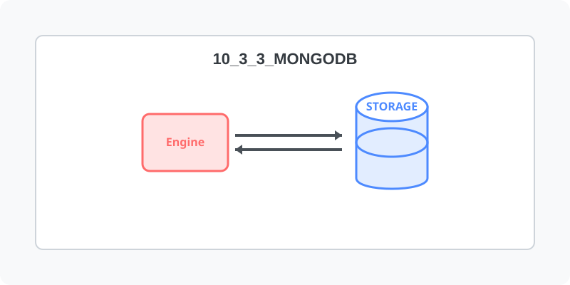

[⬅️ 이전: 테스트 및 접속하기](../10_3_2_mariadb/test/) &nbsp;|&nbsp; [🏠 분류 목차](../../../) &nbsp;|&nbsp; [다음: 12.2 MySQL / MariaDB 구축 ➡️](../10_3_4_mysql/)

# Mongo DB

---

[⬅️ 이전: 테스트 및 접속하기](../10_3_2_mariadb/test/) &nbsp;|&nbsp; [🏠 분류 목차](../../../) &nbsp;|&nbsp; [다음: 12.2 MySQL / MariaDB 구축 ➡️](../10_3_4_mysql/)
