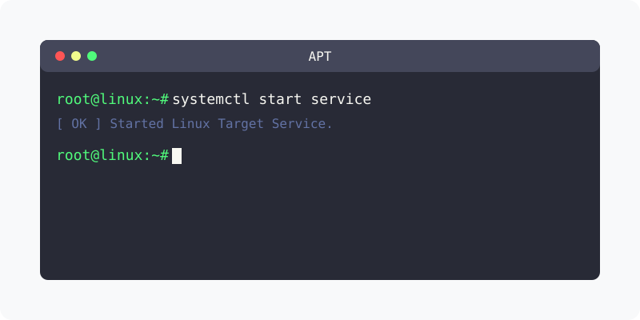

[⬅️ 이전: 12.2 MySQL / MariaDB 구축](../) &nbsp;|&nbsp; [🏠 분류 목차](../../../../) &nbsp;|&nbsp; [다음: Mysql 클라이언트 접속 ➡️](../client/)

# 우분투 Mysql 설치
우분투에서는 `apt`를 통하여 mysql을 설치가능합니다.

---

[⬅️ 이전: 12.2 MySQL / MariaDB 구축](../) &nbsp;|&nbsp; [🏠 분류 목차](../../../../) &nbsp;|&nbsp; [다음: Mysql 클라이언트 접속 ➡️](../client/)
