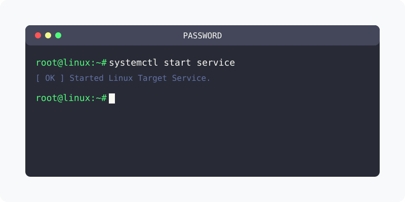

[⬅️ 이전](../) &nbsp;|&nbsp; [🏠 분류 목차](../../../)

# Mysql 패스워드 설정
데이터베이스 보완을 위하여 비밀번호를 설정합니다.

## 1️⃣ 핵심 학습 가이드
방대한 주제를 분할하여 제공합니다.

* [최초 비밀번호 확인](part_1/)

  해당 파트의 상세 내용을 학습합니다.

* [보안설정 실행](part_2/)

  해당 파트의 상세 내용을 학습합니다.

---

[⬅️ 이전](../) &nbsp;|&nbsp; [🏠 분류 목차](../../../)
