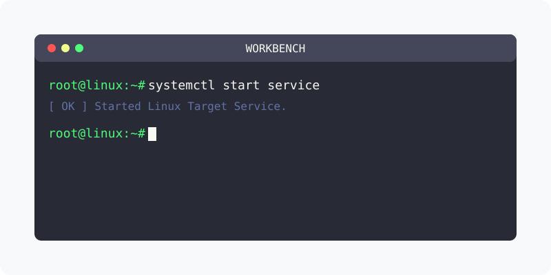

[⬅️ 이전: Mysql 서비스](../service/) &nbsp;|&nbsp; [🏠 분류 목차](../../../../) &nbsp;|&nbsp; [다음: Mysql 설치 ➡️](../yum/)

# WorkBench
`MysqlWorkBench`는 GUI 방식으로 mysql 데이터베이스에 접속을 관리하는 클리이언트 입니다.

## 설치하기

* [워크벤치 설치하기](/database/client/mysqlworkbench)

---

[⬅️ 이전: Mysql 서비스](../service/) &nbsp;|&nbsp; [🏠 분류 목차](../../../../) &nbsp;|&nbsp; [다음: Mysql 설치 ➡️](../yum/)
