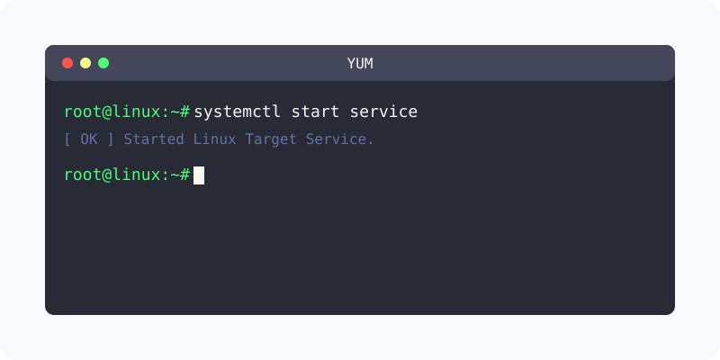

[⬅️ 이전](../) &nbsp;|&nbsp; [🏠 분류 목차](../../../)

# Mysql 설치
리눅스 서버에 Mysql 데이터베이스를 설치합니다.

방대한 주제를 분할하여 제공합니다.

## 1️⃣ 핵심 학습 가이드
* [리포지터리 확인 및 등록](part_1/)

  해당 파트의 상세 내용을 학습합니다.

* [설치하기](part_2/)

  해당 파트의 상세 내용을 학습합니다.

## 2️⃣ 심화 및 활용 파트 1
* [환경설정](part_3/)

  해당 파트의 상세 내용을 학습합니다.

* [실행 및 중지](part_4/)

  해당 파트의 상세 내용을 학습합니다.

## 3️⃣ 심화 및 활용 파트 2
* [접속하기](part_5/)

  해당 파트의 상세 내용을 학습합니다.

* [테스트 데이터베이스 만들기](part_6/)

  해당 파트의 상세 내용을 학습합니다.

## 3️⃣ 심화 및 활용 파트 2
---

[⬅️ 이전](../) &nbsp;|&nbsp; [🏠 분류 목차](../../../)
