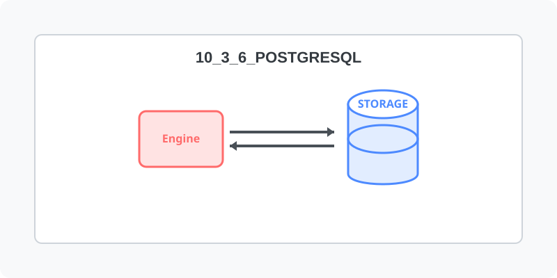

[⬅️ 이전](../) &nbsp;|&nbsp; [🏠 분류 목차](../../../)

# PostgreSql 설치하기

## 1️⃣ 핵심 학습 가이드
방대한 주제를 분할하여 제공합니다.

* [설치](part_1/)

  해당 파트의 상세 내용을 학습합니다.

* [DB 접속하기](part_2/)

  해당 파트의 상세 내용을 학습합니다.

* [사용자 추가](part_3/)

  해당 파트의 상세 내용을 학습합니다.

---

[⬅️ 이전](../) &nbsp;|&nbsp; [🏠 분류 목차](../../../)
