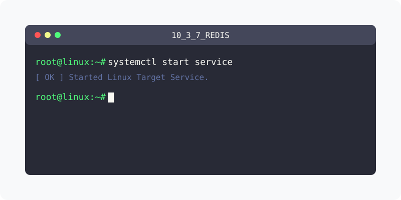

[⬅️ 이전: PostgreSql 설치하기](../10_3_6_postgresql/) &nbsp;|&nbsp; [🏠 분류 목차](../../../) &nbsp;|&nbsp; [다음: SQLight 설치하기 ➡️](../10_3_8_sqlight/)



# 리눅스에 Redis 설치하기

## Redis란?

## 설치하기
우분투에서 다음과 같이 명령을 입력하여 redis를 설치 가능합니다.

```bash
$ sudo apt install redis-server redis-tools
```

## 설정
```
vi /etc/redis/redis.conf
```

## 서버 실행과 정지

상태하기
```bash
$ systemctl status redis-server
```

redis 서버를 실행합니다.
```bash
$ service redis-server start # 시작
```

## 연동

```bash
$ redis-cli
```

---

[⬅️ 이전: PostgreSql 설치하기](../10_3_6_postgresql/) &nbsp;|&nbsp; [🏠 분류 목차](../../../) &nbsp;|&nbsp; [다음: SQLight 설치하기 ➡️](../10_3_8_sqlight/)
