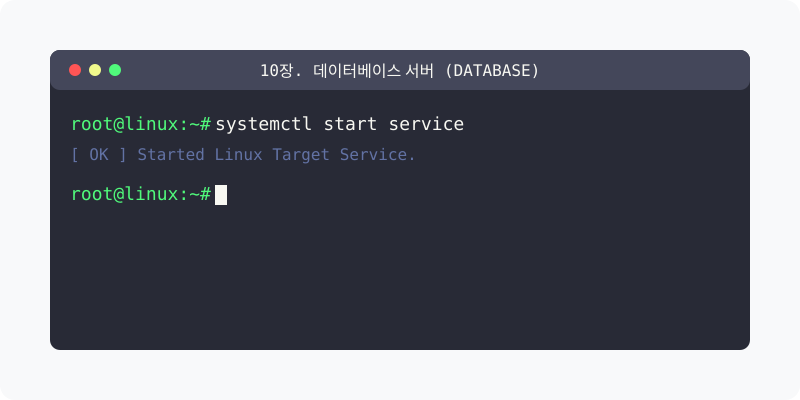

[⬅️ 이전: 9.3 WAS 연동 (Tomcat/PHP)](../10_web/09_3_was/) &nbsp;|&nbsp; [🏠 분류 목차](../) &nbsp;|&nbsp; [다음: 12.1 데이터베이스 구조 개요 ➡️](10_1_db_12/10_1_1_intro/)

# 10장. 데이터베이스 서버 (Database)

MariaDB, MySQL, Redis 등 관계형/비관계형 데이터베이스 시스템 설치 및 보안 관리 기법을 학습합니다.
아래의 세부 학습 주제를 챕터별로 클릭하여 상세 레퍼런스를 확인하세요.

## 1️⃣ 핵심 학습 목차
본 단원의 세부 커리큘럼을 안내합니다.

* [10.1 Db 12](10_1_db_12/)
  * 학습 내용: `intro, mysql, webdb`

* [10.2 Db Server](10_2_db_server/)

* [10.3 Ext Db](10_3_ext_db/)
  * 학습 내용: `client, mariadb, mongodb, mysql 등...`

---

[⬅️ 이전: 9.3 WAS 연동 (Tomcat/PHP)](../10_web/09_3_was/) &nbsp;|&nbsp; [🏠 분류 목차](../) &nbsp;|&nbsp; [다음: 12.1 데이터베이스 구조 개요 ➡️](10_1_db_12/10_1_1_intro/)
