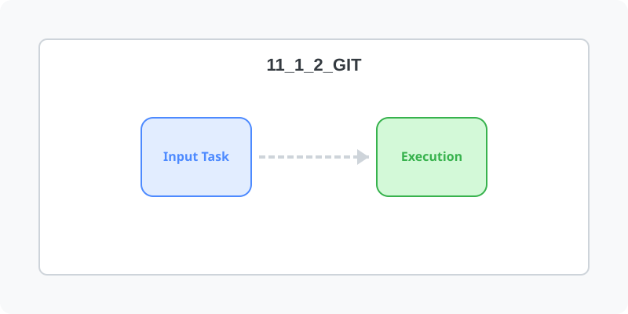

[⬅️ 이전: Curl](../11_1_1_curl/) &nbsp;|&nbsp; [🏠 분류 목차](../../../) &nbsp;|&nbsp; [다음: Volta ➡️](../11_1_3_volta/)



# 형상관리 git

## git 설치

```bash
sudo apt install git
```

## 설치확인

```bash
hojin@hojin3:/home$ git --version
git version 2.34.1
```

---

[⬅️ 이전: Curl](../11_1_1_curl/) &nbsp;|&nbsp; [🏠 분류 목차](../../../) &nbsp;|&nbsp; [다음: Volta ➡️](../11_1_3_volta/)
