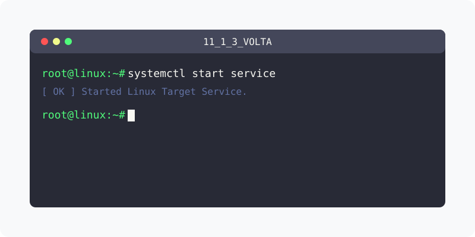

[⬅️ 이전](../) &nbsp;|&nbsp; [🏠 분류 목차](../../../)

# Volta

## 1️⃣ 핵심 학습 가이드
방대한 주제를 분할하여 제공합니다.

* [리눅스환경](part_1/)

  해당 파트의 상세 내용을 학습합니다.

* [volta로 노드 설치하기](part_2/)

  해당 파트의 상세 내용을 학습합니다.

---

[⬅️ 이전](../) &nbsp;|&nbsp; [🏠 분류 목차](../../../)
