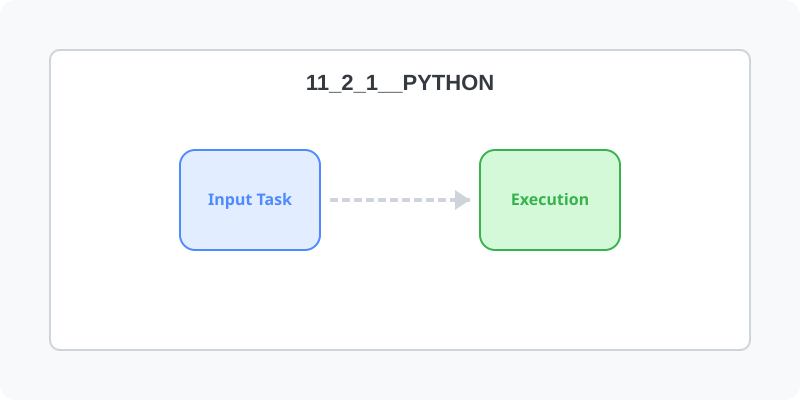

[⬅️ 이전: vscod로 원격 서버 접속하여 개발하기](../11_2_10_vscode/) &nbsp;|&nbsp; [🏠 분류 목차](../../../) &nbsp;|&nbsp; [다음: Python Setup ➡️](setup/)

# Python

* [파이썬 설치하기](/python/setup)

## 파이썬이란?

---

[⬅️ 이전: vscod로 원격 서버 접속하여 개발하기](../11_2_10_vscode/) &nbsp;|&nbsp; [🏠 분류 목차](../../../) &nbsp;|&nbsp; [다음: Python Setup ➡️](setup/)
