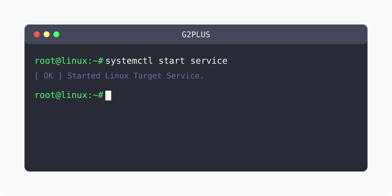

[⬅️ 이전: WSL2 gcc 설치하기 - Learn Linux](../) &nbsp;|&nbsp; [🏠 분류 목차](../../../../) &nbsp;|&nbsp; [다음: gcc hello world 출력하기 - Learn Linux ➡️](../helloworld/)



# WSL g++ 설치하기
---

```console
hojin@DESKTOP-11LMH3B:~$ g++ --version
Command 'g++' not found, but can be installed with:
sudo apt install g++
```

g++을 설치합니다.

```console
sudo apt -y install g++
```

설치가 완료된후에 다시 `g++` 명령을 입력해 봅니다.

```console
hojin@DESKTOP-11LMH3B:~$ g++ --version
g++ (Ubuntu 9.3.0-10ubuntu2) 9.3.0
Copyright (C) 2019 Free Software Foundation, Inc.
This is free software; see the source for copying conditions.  There is NO
warranty; not even for MERCHANTABILITY or FITNESS FOR A PARTICULAR PURPOSE.
```

---

[⬅️ 이전: WSL2 gcc 설치하기 - Learn Linux](../) &nbsp;|&nbsp; [🏠 분류 목차](../../../../) &nbsp;|&nbsp; [다음: gcc hello world 출력하기 - Learn Linux ➡️](../helloworld/)
