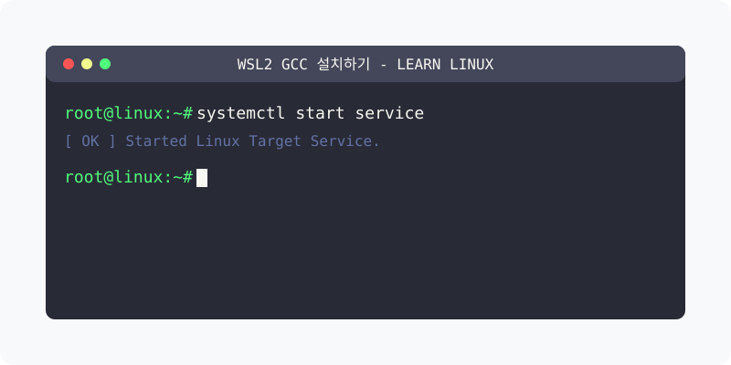

[⬅️ 이전: Python Setup](../11_2_1__python/setup/) &nbsp;|&nbsp; [🏠 분류 목차](../../../) &nbsp;|&nbsp; [다음: WSL g++ 설치하기 ➡️](g2plus/)



# WSL gcc 설치하기
---
터미널에서 gcc를 입력해 봅니다.

```console
hojin@DESKTOP-11LMH3B:~$ gcc
Command 'gcc' not found, but can be installed with:
sudo apt install gcc
```
gcc는 기본적으로 ubuntu에 설치되어 있지 않습니다. 
설치 방법에 대해서 자세히 알려 줍니다.

```console
sudo apt -y install gcc
```

`-y` 옵션을 같이 사용하면 중간에 다음과 같은 질문이 있을경우 자동적으로 `y`를 선택해 줍니다.

```console
Do you want to continue? [Y/n] y
```

설치가 완료된후에 다시 `gcc` 명령을 입력해 봅니다.

```console
hojin@DESKTOP-11LMH3B:~$ gcc --version
gcc (Ubuntu 9.3.0-10ubuntu2) 9.3.0
Copyright (C) 2019 Free Software Foundation, Inc.
This is free software; see the source for copying conditions.  There is NO
warranty; not even for MERCHANTABILITY or FITNESS FOR A PARTICULAR PURPOSE.
```

<br>

## gcc 실습
---
hello world 프로그램을 작성해 봅니다. [>>실습](./helloworld/)

<br>

## gcc 스터디
---
본격적으로 gcc를 학습을 해보도록 합니다. 

---

[⬅️ 이전: Python Setup](../11_2_1__python/setup/) &nbsp;|&nbsp; [🏠 분류 목차](../../../) &nbsp;|&nbsp; [다음: WSL g++ 설치하기 ➡️](g2plus/)
