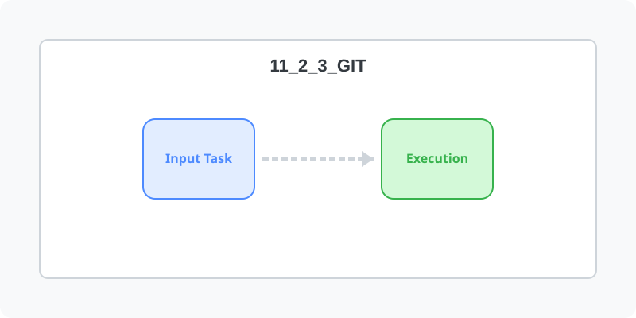

[⬅️ 이전: gcc hello world 출력하기 - Learn Linux](../11_2_2_gcc/helloworld/) &nbsp;|&nbsp; [🏠 분류 목차](../../../) &nbsp;|&nbsp; [다음: Go ➡️](../11_2_4_go/)



# git deploy

git init --bare

cd hooks
vi post-receive

```sh
#!/bin/bash
git --work-tree=/var/www/html --git-dir=/home/nugupoem/bare.git checkout -f

```

실행파일 추가
```bash
chmod +x post-receive
```

## 개발PC

git remote add server ssh://root@101.101.164.248/home/nugupoem/bare.git

---

[⬅️ 이전: gcc hello world 출력하기 - Learn Linux](../11_2_2_gcc/helloworld/) &nbsp;|&nbsp; [🏠 분류 목차](../../../) &nbsp;|&nbsp; [다음: Go ➡️](../11_2_4_go/)
