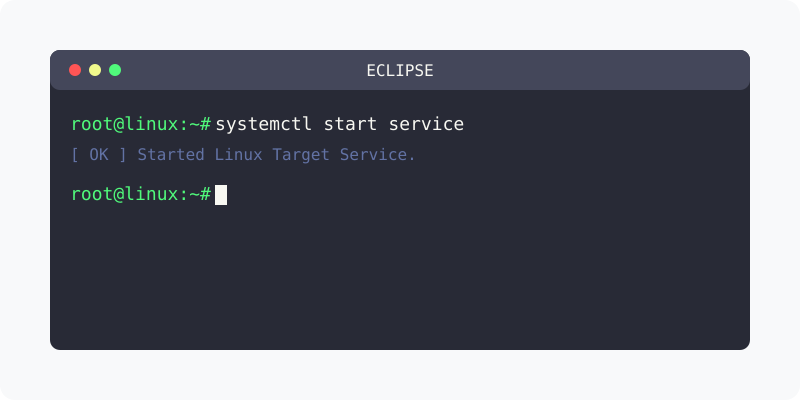

[⬅️ 이전](../) &nbsp;|&nbsp; [🏠 분류 목차](../../../)

방대한 주제를 분할하여 제공합니다.

## 1️⃣ 핵심 학습 가이드
* [톰켓 연동 개발](part_1/)

  해당 파트의 상세 내용을 학습합니다.

* [학습목표](part_2/)

  해당 파트의 상세 내용을 학습합니다.

## 2️⃣ 심화 및 활용 파트 1
* [Web 서버와 WAS](part_3/)

  해당 파트의 상세 내용을 학습합니다.

* [이클립스와 톰켓 연동](part_4/)

  해당 파트의 상세 내용을 학습합니다.

## 3️⃣ 심화 및 활용 파트 2
* [실습 login Servlet](part_5/)

  해당 파트의 상세 내용을 학습합니다.

* [apache와 tomcat 둘다 활용](part_6/)

  해당 파트의 상세 내용을 학습합니다.

## 3️⃣ 심화 및 활용 파트 2
---

[⬅️ 이전](../) &nbsp;|&nbsp; [🏠 분류 목차](../../../)
