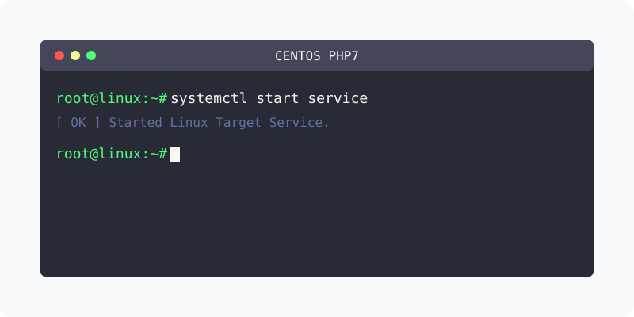

[⬅️ 이전](../) &nbsp;|&nbsp; [🏠 분류 목차](../../../)

# php 7.2 centos 설치

CentOS는 yum을 이용하여 php 페키지를 설치할 수 있습니다.

방대한 주제를 분할하여 제공합니다.

## 1️⃣ 핵심 학습 가이드
* [php 버전](part_1/)

  해당 파트의 상세 내용을 학습합니다.

* [yum 저장소 추가](part_2/)

  해당 파트의 상세 내용을 학습합니다.

* [설치](part_3/)

  해당 파트의 상세 내용을 학습합니다.

## 2️⃣ 심화 및 활용 파트 1
* [웹서버 재시작](part_4/)

  해당 파트의 상세 내용을 학습합니다.

* [추가설치](part_5/)

  해당 파트의 상세 내용을 학습합니다.

* [확인 및 테스트](part_6/)

  해당 파트의 상세 내용을 학습합니다.

## 3️⃣ 심화 및 활용 파트 2
* [참조 블로그 및 url](part_7/)

  해당 파트의 상세 내용을 학습합니다.

## 3️⃣ 심화 및 활용 파트 2
---

[⬅️ 이전](../) &nbsp;|&nbsp; [🏠 분류 목차](../../../)
