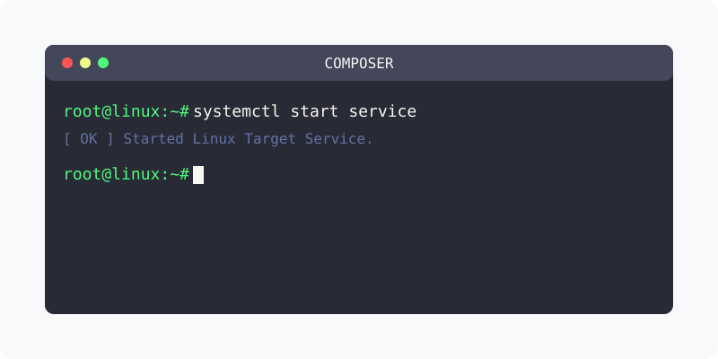

[⬅️ 이전](../) &nbsp;|&nbsp; [🏠 분류 목차](../../../)

# PHP 컴포저 설치
컴포저를 이용하여 다양한 응용 패키지와 연동을 합니다.

 

## 1️⃣ 핵심 학습 가이드
방대한 주제를 분할하여 제공합니다.

* [다운로드](part_1/)

  해당 파트의 상세 내용을 학습합니다.

* [설치하기](part_2/)

  해당 파트의 상세 내용을 학습합니다.

* [컴포저 실행하기](part_3/)

  해당 파트의 상세 내용을 학습합니다.

---

[⬅️ 이전](../) &nbsp;|&nbsp; [🏠 분류 목차](../../../)
