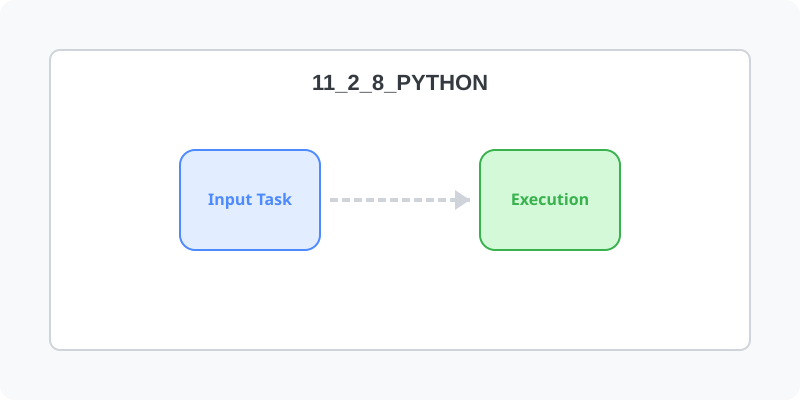

[⬅️ 이전: 셈플코드 작성](../11_2_7_php/sample/) &nbsp;|&nbsp; [🏠 분류 목차](../../../) &nbsp;|&nbsp; [다음: Rust ➡️](../11_2_9_rust/)



# Python

## WSL에서 파이썬 개발하기

## 설치확인
---
기본적으로 python 3.x 이상의 버젼이 설치되어 있습니다.

```console
hojin@DESKTOP-11LMH3B:~$ python3 --version
Python 3.8.2
```

---

[⬅️ 이전: 셈플코드 작성](../11_2_7_php/sample/) &nbsp;|&nbsp; [🏠 분류 목차](../../../) &nbsp;|&nbsp; [다음: Rust ➡️](../11_2_9_rust/)
