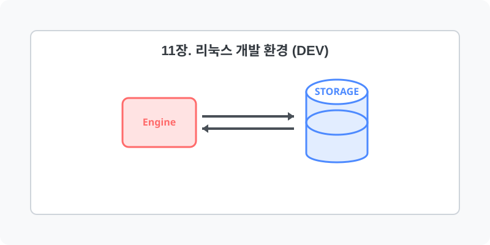

[⬅️ 이전: SQLight 설치하기](../11_database/10_3_ext_db/10_3_8_sqlight/) &nbsp;|&nbsp; [🏠 분류 목차](../) &nbsp;|&nbsp; [다음: 도구설정 ➡️](11_1_tools/)

# 11장. 리눅스 개발 환경 (Dev)

Git, VS Code, GCC 및 Python, Java 등 다양한 프로그래밍 스택을 리눅스 기반 워크스테이션에 통합합니다.
아래의 세부 학습 주제를 챕터별로 클릭하여 상세 레퍼런스를 확인하세요.

## 1️⃣ 핵심 학습 목차
본 단원의 세부 커리큘럼을 안내합니다.

* [11.1 Tools](11_1_tools/)
  * 학습 내용: `curl, git, volta, vscode`

* [11.2 Ext Dev](11_2_ext_dev/)
  * 학습 내용: `vscode, _python, gcc, git 등...`

---

[⬅️ 이전: SQLight 설치하기](../11_database/10_3_ext_db/10_3_8_sqlight/) &nbsp;|&nbsp; [🏠 분류 목차](../) &nbsp;|&nbsp; [다음: 도구설정 ➡️](11_1_tools/)
