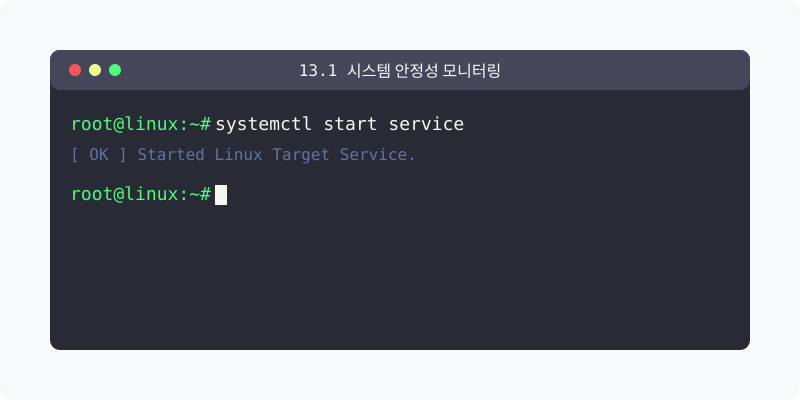
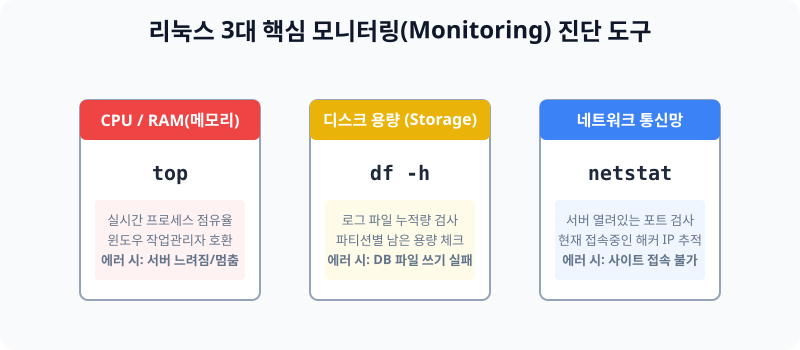

[⬅️ 이전: 12장. 시스템 모니터링 및 성능 체크 (Monitoring)](../) &nbsp;|&nbsp; [🏠 분류 목차](../../) &nbsp;|&nbsp; [다음: 디스크 모니터링 ➡️](../12_2_disk/)



# 13.1 내 서버 컴퓨터의 건강 진단 (시스템 모니터링)

아무리 완벽하게 세팅된 서버라도 시간이 지나면 메모리가 새거나 하드디스크가 꽉 차서 뻗게 마련입니다. 시스템 엔지니어의 가장 중요한 일과는 출근하자마자 까만 터미널 화면에 진단 명령어를 쳐보고, 서버가 건강한지 의사처럼 청진기를 대보는 일입니다.


> **동작 원리**: 서버의 3대 핵심 자원은 **CPU(뇌), RAM(책상), Disk(창고)** 입니다. 이 3가지 자원 중 단 하나라도 100% 점유율에 도달하면 그 즉시 리눅스는 작동을 멈추거나 뻗어버립니다. 각 자원을 측정하는 특화된 명령어를 통해 병목(Bottleneck) 현상을 선제적으로 찾아내야 합니다.

---

## 1. 3대 핵심 자원 모니터링 명령어

리눅스에 기본으로 내장된 대표적인 3개의 명령어를 반드시 숙지해야 합니다.

### 1.1 CPU와 메모리 점유율 보기 (`top`)
* 윈도우의 `[Ctrl+Alt+Del] -> 작업 관리자` 와 완전히 똑같은 역할을 하는 강력한 프로세스 스캐너입니다.
* 맨 위에 현재 CPU가 몇 프로 도는지 나타나며, 밑에는 메모리를 가장 많이 잡아먹고 있는 악성(?) 프로그램들이 실시간 목록으로 갱신되며 뜹니다. 나갈 때는 `q` 키를 누릅니다.

### 1.2 하드디스크 용량 보기 (`df -h`)
* `Disk Free`의 약자로, 전체 하드디스크 용량 중 몇 기가바이트(GB)가 찼는지 퍼센티지로 보여줍니다.
* 특히 데이터베이스가 설치된 서버나 로그가 쌓이는 서버는 방치하면 디스크가 100%가 넘어가 시스템 자체가 먹통이 되므로 주기적으로 타건해야 합니다.

### 1.3 네트워크 활성 확인 (`netstat`)
* 현재 내 서버에 연결된 모든 IP 추적 목록과, 내가 현재 귀를 열고 대기(LISTEN)중인 포트 번호(22, 80, 3306 등)를 잡아냅니다.
* 서비스가 켜져 있어도 포트가 안 돌면 남이 못 들어옵니다.

---

## 2. 기타 유용한 진단 명령어들

* [uptime](uptime) : 현재 서버가 몇 달, 며칠째 안 꺼지고 버티고 있는지 `Load Average (부하량 평균)`과 함께 1줄로 요약해 보여줍니다. 
* [vmstat](vmstat) : 가상 메모리(Virtual Memory)와 페이징 통계를 실시간 수치로 리포팅합니다.
* [iostat](iostat) : 하드디스크가 돌면서 데이터를 물리적으로 읽고 쓰는(I/O 속도) 한계치를 모니터링합니다.

---

## 3. [실습] 진짜 서버 엔지니어처럼 진단해보기

서버에 접속하자마자 기계적으로 타건해야 하는 3단 콤보 실습을 진행합니다.

### 실습 1. CPU 청진기 가동
```bash
# 실시간으로 순위를 갱신하며 위아래로 움직이는 프로세스들을 봅니다.
top

# (주의) 무한히 돌고 있으므로, 구경이 끝났다면 키보드 [ q ] 를 눌러 빠져나옵니다.
```

### 실습 2. 하드디스크 잔여량 점검
```bash
# -h 스크립트를 안 붙이면 사람이 읽을 수 없는 바이트 숫자로 뜹니다.
df -h
```
결과 중에 `Use%` 항목이 90%가 넘어간 빨간불 타겟 디렉터리가 있는지 점검해 봅니다.

### 실습 3. 내가 오픈한 통신 항구 검색
```bash
# 내 서버가 어떤 포트로 문을 열어두었는지 점검합니다.
sudo netstat -ntlp
```
결과 중에 `22 (SSH)`, `80 (웹)`, `3306 (DB)` 포트가 `LISTEN` 상태로 잘 열려 있는지 확인합니다!

---

[⬅️ 이전: 12장. 시스템 모니터링 및 성능 체크 (Monitoring)](../) &nbsp;|&nbsp; [🏠 분류 목차](../../) &nbsp;|&nbsp; [다음: 디스크 모니터링 ➡️](../12_2_disk/)
