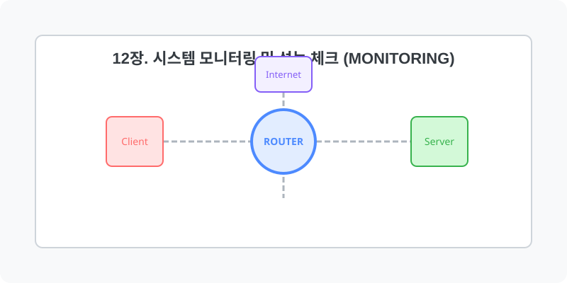

[⬅️ 이전: 13.2 오픈소스 클라우드 스토리지 (Nextcloud)](../13_app/13_2_cloud_drive/) &nbsp;|&nbsp; [🏠 분류 목차](../) &nbsp;|&nbsp; [다음: 13.1 시스템 안정성 모니터링 ➡️](12_1_resource/)

# 12장. 시스템 모니터링 및 성능 체크 (Monitoring)

서버의 3대 핵심 자원(CPU, RAM, Disk)과 네트워크의 병목 현상을 진단하고 부하량을 측정하여 서버 정지와 장애를 예방하는 엔지니어링 관제 기법을 배웁니다.
아래의 세부 학습 주제를 챕터별로 클릭하여 상세 레퍼런스를 확인하세요.

## 1️⃣ 핵심 학습 목차
본 단원의 세부 커리큘럼을 안내합니다.

* [12.1 Resource(CPU/RAM)](12_1_resource/)
  * 주요 도구: `top`, `free`, `ps`, `kill`

* [12.2 Disk(저장공간)](12_2_disk/)
  * 주요 도구: `df`, `du`, `iostat`

* [12.3 Network(트래픽/연결)](12_3_network/)
  * 주요 도구: `netstat`, `ping`

---

[⬅️ 이전: 13.2 오픈소스 클라우드 스토리지 (Nextcloud)](../13_app/13_2_cloud_drive/) &nbsp;|&nbsp; [🏠 분류 목차](../) &nbsp;|&nbsp; [다음: 13.1 시스템 안정성 모니터링 ➡️](12_1_resource/)
